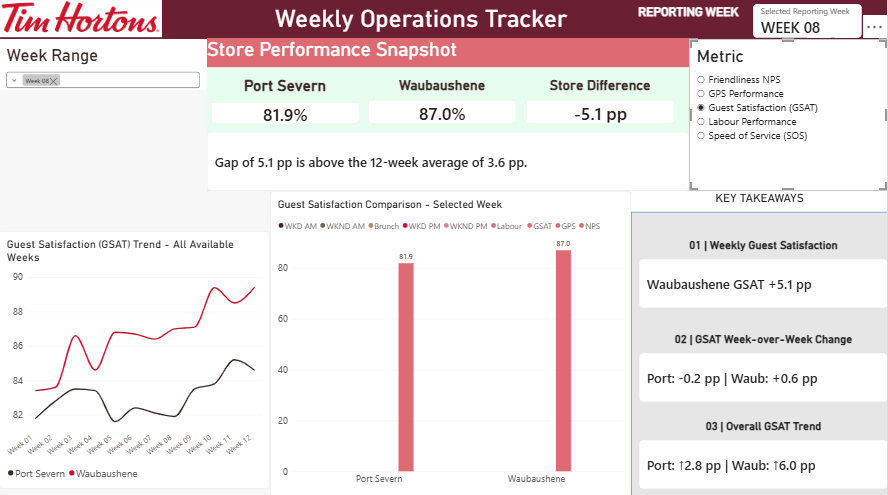

# Weekly Operations Tracker – Power BI Dashboard

<p align="center">
  
</p>

<p align="center">
  <strong>Power BI Dashboard | Restaurant Operations | Weekly Performance Analysis</strong>
</p>

---

## Project Overview

The Weekly Operations Tracker is an interactive Power BI dashboard designed to monitor and compare weekly restaurant operational performance across two Tim Hortons locations:

- **Port Severn** – Store ID: 5349
- **Waubaushene** – Store ID: 5201

The dashboard provides a consolidated view of key operational metrics, helping management compare store performance, identify trends and monitor areas requiring attention.

This project was developed as a portfolio demonstration using fictional sample data.

## Download Power BI Dashboard

[Download Weekly Operations Tracker (.pbix)](Dashboard/Weekly_Operations_Tracker.pbix)

To open the dashboard, download the PBIX file and open it using Microsoft Power BI Desktop.


## Business Objectives

The main objectives of this project are to:

- Compare weekly operational performance between two restaurant locations.
- Monitor Speed of Service across different dayparts.
- Track Guest Satisfaction and Friendliness NPS.
- Evaluate GPS performance and Labour Performance.
- Identify week-over-week changes and longer-term performance trends.
- Present actionable operational insights through a single interactive dashboard.

## Tools & Technologies

- **Microsoft Power BI Desktop** – Dashboard development and data visualisation
- **DAX** – Measures, calculations and dynamic insights
- **Microsoft Excel** – Sample data preparation
- **Power BI Data Model** – Data organisation and reporting structure

## Key Performance Metrics

The dashboard monitors five key operational metrics:

| Metric | Purpose |
|---|---|
| Speed of Service (SOS) | Monitors service speed across five dayparts |
| Guest Satisfaction (GSAT) | Tracks customer satisfaction performance |
| Friendliness NPS | Measures customer perceptions of friendliness |
| GPS Performance | Monitors overall GPS performance |
| Labour Performance | Tracks labour percentage across locations |

## Dashboard Features

### 1. Dynamic Metric Selection

Users can select any of the five operational metrics. The KPI cards, comparison chart, trend chart and key takeaways respond to the selected metric.

### 2. Weekly Store Comparison

The dashboard compares Port Severn and Waubaushene for the selected reporting week, including the difference between the two locations.

### 3. Historical Trend Analysis

The trend chart displays performance across the available reporting weeks, allowing management to monitor changes over time.

### 4. Key Operational Takeaways

Dynamic insights highlight:

- Weekly performance differences between the two stores.
- Week-over-week performance changes.
- Longer-term performance trends and relevant operational observations.

### 5. Interactive Reporting

The dashboard includes a reporting-week slicer and a metric selector, allowing users to explore operational performance from different perspectives.

## Dashboard Screenshots

The following screenshots demonstrate how the dashboard responds to different metric selections.

### Speed of Service (SOS)


### Guest Satisfaction (GSAT)



### Labour Performance


### Friendliness NPS


### GPS Performance


## Data Model & Calculations

The project uses a structured weekly operational dataset containing reporting-week information, store details and operational performance metrics.

DAX measures were developed to support:

- Store-level KPI calculations.
- Performance differences between locations.
- Dynamic metric selection.
- Week-over-week comparisons.
- Historical trend analysis.
- Dynamic titles and operational takeaways.

A disconnected metric selector and trend-week axis were used to support dynamic reporting and historical analysis.

## Business Value

This dashboard demonstrates how restaurant operational data can be converted into meaningful management insights.

It helps management:

- Compare performance across restaurant locations.
- Identify operational strengths and improvement opportunities.
- Monitor service speed, customer satisfaction and labour performance.
- Understand changes in performance over time.
- Support data-driven operational decisions.

## Future Enhancements

Potential future improvements include:

- Connecting the dashboard to actual weekly restaurant reports.
- Automating the weekly data refresh process.
- Adding additional operational KPIs where reliable data is available.
- Expanding the analysis to additional restaurant locations.

## Project Structure

```text
weekly-operations-tracker-powerbi/
│
├── Dashboard/
│   └── Final Power BI file (.pbix)
│
├── Screenshots/
│   ├── None.png
│   ├── SOS.png
│   ├── GSAT.png
│   ├── Labour.png
│   ├── NPS.png
│   └── GPS.png
│
├── Documentation/
│   └── Project Report (PDF)
│
└── README.md
```

## Project Status

**Completed** – Dashboard development, dynamic metric selection, store comparisons, historical trend analysis and operational takeaways.

## Note on Sample Data

This portfolio project uses fictional sample data for demonstration purposes. The store performance figures shown in the dashboard do not represent actual Tim Hortons business results or confidential company information.
